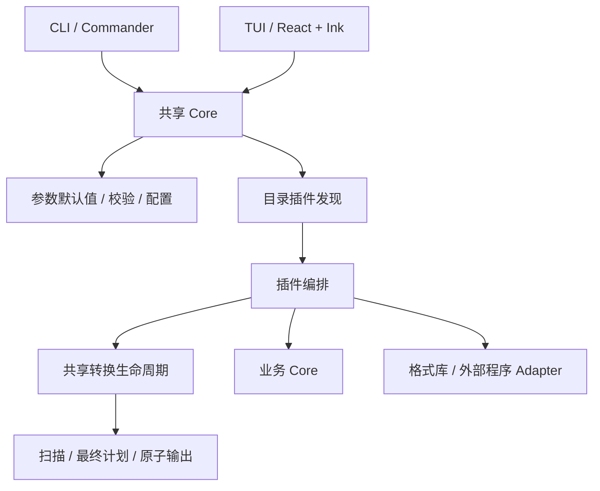

# Aboom Toolbox 架构

单包 TypeScript 项目，pnpm 管理依赖，CLI 使用 Commander，TUI 使用 React + Ink，tsdown 构建。插件从目录自动发现。

## 参数与入口

公开入口为 `src/core/index.ts`。Core 不依赖 UI，也不会因导入而扫描插件。插件默认导出 `run(options, context)`，可选 `check(options)`，业务与 Adapter 分离。

参数默认值与校验由 `defaultOptions`、`fieldDefault`、`validFieldValue` 统一提供。配置只验证已有字段，执行入口补齐默认值；显式参数 > 配置 > 描述默认值，保留 false 和空字符串。

`ToolField.choices` 为字符串数组，`choiceDescriptions` 可提供按值索引的说明；描述验证拒绝重复选项和不属于 choices 的说明键。原有描述和 schemaVersion 1 继续可用。

CLI 只读取 Commander 中用户显式传入的选项，无参数显示帮助，`tui` 命令动态加载 TUI。配置来源和路径规则见 [README](../README.md#默认配置)。

## 共享转换生命周期

`runConversion(options, context, spec)` 统一执行：

1. 确认输入、确定根目录与候选输出路径，扫描符合格式的文件。
2. 可选 `prepare(job)` 计算最终文件名及业务数据；逐文件准备失败进入批次错误。
3. 校验最终输出名称、源文件覆盖和同名碰撞。
4. 可选 `beforeRun(jobs, context, paths)` 检查依赖；音频指定目录内全部结果已存在时可直接跳过，自动模式始终准备新目录所需的依赖。
5. 自动模式原子占用新目录并重定位全部任务；预览只保留候选路径。
6. 串行执行 `write(job, temporary)`，成功后提交输出，汇总逐文件结果。
7. 清理临时文件及本次创建的空目录，保留已完成输出。

`ConversionSpec<T>` 声明 sourceExtension、targetExtension、可选 ignoreOfficeTemporary，以及 prepare/beforeRun/write/preview 回调。`PreparedJob<T>` 携带 source、output、data。prepare 可返回新的 basename 和业务数据；write 只写临时路径，可返回结果说明。

`resolveConversionPaths` 是异步函数，返回 input、root、output、automatic、outputGrowO。output 空值表示自动，非空值表示指定路径。output-grow-o 默认 true，重名时增加中间的 o；false 则从 aboom_output 起追加数字 1、2、3。候选路径与实际占用使用同一规则；mkdir 非递归占用，EEXIST 重试。文件、目录和链接均占名。

扫描排除目录链接、Office 临时表（Excel）、嵌套输出及两种模式的历史目录：abo{2,}m_output 或 aboom_output[1-9][0-9]*。路径身份比较遵循当前系统的大小写规则。原子输出用同目录临时文件、rename 覆盖或硬链接独占提交；文件系统需要支持硬链接。

Excel 默认 table，sfx 显式选择，Adapter 读取公式缓存；图片先规划最终后缀，再统一检查碰撞；FFmpeg 使用参数数组，子进程不经过 shell。

## TUI 与异步生命周期

TUI 分为纯状态转换、Unicode 文本编辑、异步控制器和视图。状态覆盖 menu/form/select/confirm/running/result；选择列表的临时选中值仅在确认后进入表单。

控制器同步保存最新状态，确保同批导航与 Enter 使用新选择。每个任务和依赖检测使用递增标识，过期回调和卸载后的回调失效；运行期间不接受重复启动。草稿仅存于会话，不写配置。

CLI/TUI 共用 `checkAvailability`，同步异常及异步拒绝转换成可展示的不可用状态。执行时插件重新检查真实依赖。

`ProgressEvent.phase` 可为 scan/prepare/convert，旧插件可省略。界面按阶段显示状态，转换计数只在文件完成后增长。Excel 与图片在安全点取消，FFmpeg 主动终止子进程。

## 构建与分发

tsdown 分别生成 core.mjs、cli.mjs、tui.mjs 和目录插件；CLI 按需加载 TUI，插件导入公开 Core 入口。只构建项目代码，运行依赖由 npm 安装，Yoga WASM 与 sharp 平台资源由依赖自身提供。标准 npm TGZ 保留 dist/ 布局和运行依赖声明，同一包可在依赖支持的系统与架构安装。

Node.js 与 FFmpeg 由本机提供。开发任务完成时只进行源码检查和按需构建，不自动 pack；用户自行验证后主动运行 pnpm package 生成 npm 候选包。pnpm test:package 包含临时 pack，只有主动需要分发验收时才执行。本地分发步骤见 [构建与打包](release.md)。
